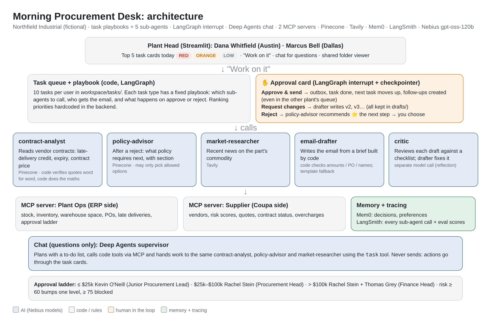

# Morning Procurement Desk

A multi-agent procurement assistant for two **Plant Heads** at a fictional manufacturer. Each one opens the app on their **top 5 tasks for today** (red, then orange, then low). Click **Work on it** and the sub-agents do the work: they read the vendor contract, check policy, scan the market and draft the email. The app then **pauses for your OK**.

- **Approve and send:** the email goes out, the task leaves the list and the next one moves up.
- **Request changes:** the drafter writes a new version.
- **Reject:** the policy-advisor says what policy requires next, and you choose.

Built for *Mastering AI*, Week 3 (multi-agent systems, sub-agents, MCP, memory, human in the loop).
**All data is fictional:** Northfield Industrial, its plants, people, vendors and contracts are invented.



## Who uses it

| User | Plant | Their 10 tasks today |
|---|---|---|
| **Dana Whitfield**, Plant Head | Austin | 3 red, 3 orange, 4 low |
| **Marcus Bell**, Plant Head | Dallas | 2 red, 3 orange, 5 low |

The two queues are linked. When Dana approves a restock that needs stock moved from Dallas, a **red transfer request appears at the top of Marcus's list**. If Marcus declines it, Dana gets a red "re-source" task.

## The sub-agents (the focus of this project)

| Sub-agent | What it does | Tools | How we keep it honest |
|---|---|---|---|
| **contract-analyst** | Reads the vendor's Master Supply Agreement: late-delivery credit, expiry, renewal notice, contract price, payment terms | Pinecone (15 contracts) | Code checks every quote is **word for word** in the contract. For claims, code also reads clause 5.2 itself and compares: if the analyst misread a number, the clause wins and the card says so. Code does the maths. |
| **policy-advisor** | After you reject something, says what policy requires next and recommends one of the allowed options, citing the section | Pinecone (5 plant policies + 2 company policies) | It can only pick from options the code allows |
| **market-researcher** | Recent news on the part's commodity or region | Tavily | Links shown; used as context only |
| **email-drafter** | Writes the email from a brief built by code | model only | Code checks the email has the exact amounts, PO numbers and names; one retry, else a safe template |
| **critic** | Reviews each draft against a checklist (e.g. policy section 7) before you see it; the drafter fixes what it finds | separate model call (`JUDGE_MODEL`) | Reflection pattern |

A **chat supervisor** (Deep Agents) sits below the task list for questions ("What does Juniper's contract say about late delivery?"). It plans with a to-do list and hands work to the same contract-analyst, policy-advisor and market-researcher using the `task` tool. Chat is **questions only**: anything that sends goes through a task card with a human approval step.

## What a Plant Head can ask (chat)

The chat is prepared for the questions a Plant Head really asks. Each type goes to a fixed tool or sub-agent, so the numbers come from code, not from the model.

| Area | Example questions | Answered by |
|---|---|---|
| **Restock and vendor choice** | "We're low on hydraulic pumps, what are my options?" · "Order 80 P-110" · "Which vendor is fastest for 10 servo motors?" · "Why Evergreen over Apex?" | `recommend_restock`: stock and run-out, vendor list with **contract price vs quote**, risk score, 3 options ranked on **cost, speed and risk**, blocked vendors, approver, **policy checks** with sections |
| **Transfers** | "Does another plant have spare P-110?" | `find_nearby_surplus`: the plant, surplus quantity, truck days and cost, and **"Check with Marcus Bell (Dallas Plant Head)"** |
| **Inventory and space** | "What's below safety stock?" · "What runs out in 14 days?" · "Will 500 steel sheets fit?" | stock, inventory and warehouse tools |
| **Vendors, quotes, contracts** | "Which vendors supply P-110 and at what contract price?" · "Is Evergreen's quote still valid?" · "Juniper's late-delivery terms?" · "Payment terms with Evergreen?" | vendor and quote tools; **contract-analyst** (Pinecone, quotes checked word for word) |
| **Vendor risk** | "Can I use Ironwood?" · "What does Lumen's risk 63 mean for approvals?" | risk tool + approval rules |
| **Orders and deliveries** | "When will my P-110 order arrive?" · "Status of PO-24137?" · "Which deliveries were late?" · "How much can we claim?" · "Are we overcharged?" | open-order, PO, late-delivery and overcharge tools; contract-analyst + penalty calculator |
| **Policy and approvals** | "Who approves $150k?" · "Emergency purchase rules?" · "What if my request is rejected?" · "Do I need 3 quotes?" | approval ladder in code; **policy-advisor** (plant + company policies) |
| **Tasks and market** | "What should I work on today?" · "Steel market news?" | task queue; market-researcher (Tavily) |

**Guardrails for a low failure rate and high faithfulness:**
1. **Scope filter.** A small model call checks each question first. Out-of-scope questions (weather, HR, revenue, maintenance, flights…) get a clear *"I can't help with that: it's outside this procurement desk"* plus what it can do. No tools are called, so there is no cost. Mixed questions get the procurement part answered and the rest called out.
2. **No actions from chat.** It won't approve, pay, place orders or change data (like a risk score). It says who can, or which task card does it.
3. **Unknown items.** Unknown parts, vendors or POs get "not in the system", plus close matches. Part names in words are looked up with `find_parts`.
4. **Faithfulness check (code).** Every number, date and ID in the answer is compared with the tool results. If something isn't found, the agent gets one chance to correct it. Anything still unsupported is shown to the user as ⚠️. Otherwise the answer shows ✅ "N values checked".

## Task scenarios: what happens on approve and on reject

| Task (example) | Sub-agents used | If you **approve** | If you **reject**, the policy-advisor offers |
|---|---|---|---|
| **Restock** P-110 (red), guided: 1) how many do you need? 2) another plant has spare: ask its Plant Head for a transfer (how many)? 3) which vendor for the rest? (ranked; below a vendor's contract minimum the quantity is raised to the minimum and the card says so) 4) purchase request | contract-analyst, market-researcher, drafter, critic | Transfer email to the other Plant Head, then a red transfer request in their queue. Purchase request to the right approver(s) | Next vendor · **change the quantity** (re-checks the approver) · escalate to the Procurement Head · withdraw. Declining the transfer orders everything from the vendor |
| **Overdue PO from a high-risk vendor** (red) | contract-analyst | Expedite email: ship date within 2 business days. A **"cancel if no ship date"** task is created. | Cancel now and re-source, which creates a red restock task |
| **Open PO, contract expired** (red) | contract-analyst | Exception request to the Procurement Head (policy: 90-day exception) | Cancel the PO and re-source |
| **Late-delivery claim** (orange) | contract-analyst reads the clause, code calculates | Claim email to the vendor with the exact amount. A "check credit note" follow-up is created. | $1,000 or more: waiver request to the Procurement Head (policy §5) · under $1,000: waive (reason recorded) |
| **Price above contract** (orange) | contract-analyst | Price-correction request to the vendor | Ask the Procurement Head for written acceptance (required by policy §4) |
| **Contract renewal** (orange) | contract-analyst; code applies the fill-rate rule | Recommendation to the Procurement Head. A "send notice to vendor" task is created. | Non-renewal notice to the vendor · RFQ to two other vendors |
| **Transfer request from the other plant** | none (code) | Confirmation; the requester gets "transfer confirmed" | Decline (email with the reason). The requester gets a red **"Amend purchase request"** task: an email to the approver replacing the earlier request with old qty + declined qty (e.g. 32 + 8 = 40, $75,440); if the new total crosses a threshold the approver changes (e.g. Finance Head added above $100,000). If no request was sent yet, a red "cover it another way" task instead |
| Quote refresh / ship-date confirm / vendor notice (low) | drafter, critic | Email sent, task done | Close or snooze |
| Market watch / vendor review / space check (low) | market-researcher or code | Information card: mark done or snooze | |

On every reject the **policy-advisor** runs first and marks its recommendation with a ⭐. Every path ends in a clear state: **done**, **closed** or **snoozed** (leaves today's list). Some paths also create a follow-up task.

## Policies (in Pinecone, enforced in code)

**Approval ladder.** The Plant Head raises every purchase request, and the email comes from them. Who approves depends on the total including freight:

| PO total | Approver(s) |
|---|---|
| up to $25,000 | Kevin O'Neill, Junior Procurement Lead |
| $25,000 – $100,000 | Rachel Stein, Procurement Head |
| above $100,000 | Rachel Stein (Procurement Head) **and** Thomas Grey (Finance Head) |

A vendor risk of 60 or more moves the approval up one level. A risk of 75 or more is blocked.

**Company-wide policies (new):**
- **Contract Management** (`POL-GLOBAL-CONTRACTS-2026`) covers:
  - expired contracts (90-day exception or cancel);
  - renewal by fill rate (95% or more renew, 85–95% renegotiate, under 85% exit or RFQ);
  - prices above contract;
  - waiving late-delivery credits ($1,000 or more needs the Procurement Head);
  - overdue orders from high-risk vendors.
- **Purchase Order Raising** (`POL-GLOBAL-PO-2026`) covers:
  - checking other plants first;
  - comparing 3 vendors;
  - what to do **after a rejection**;
  - split deliveries.

## Architecture decisions

- **Fixed playbooks for actions, AI for judgement.** In testing, a free-roaming supervisor sometimes skipped steps or invented a draft ID. So each task type has a playbook in code (which sub-agents to call, who gets the email, what happens on approve or reject). The sub-agents do the reading, advising and writing.
- **Numbers and rules are code.** This covers quantities, rankings, approvers, penalties and blocking rules. It makes them cheap, fast and testable.
- **Two MCP servers**, like a real company: **Plant Ops** (ERP side) and **Supplier** (Coupa or Ariba side).
- **Human in the loop with LangGraph** `interrupt()` and a checkpointer. The task pauses on the approval card and resumes exactly where it left off.
- **Shared folder** (like the Deep Agents demo):
  - `workspace/drafts/` holds every email version (`AUS-01_main_v1.md`, `_v2.md`…) and the forms;
  - `workspace/research/` holds the sub-agents' findings;
  - `workspace/outbox/` holds what was sent after your OK.
- **Memory:** Mem0 logs each decision for the Plant Head and keeps lasting preferences ("never use Lumen Sensors").
- **Tracing:** every sub-agent call shows up in LangSmith.
- **Your quantity wins.** If you ask for a quantity ("order 80 P-110"), every option is priced for 80; the calculated need (32) is shown for comparison, warehouse space becomes a split delivery, and the approver follows the new total ($150,640 → Procurement Head + Finance Head).
- **Ranking priorities are hardcoded** in the backend (cost, speed and risk weights in `src/core/workflows.py`). A per-user editor is a future expansion.

## Run it (Mac, Python 3.12)

```bash
python3.12 -m venv .venv && source .venv/bin/activate
pip install -r requirements.txt
cp .env.example .env            # add your keys (never commit .env)
python selfcheck.py             # checks every connection and says what to fix
python -m src.ingest            # contracts + policies into Pinecone (re-run after policy changes)
streamlit run app.py            # http://localhost:8501, then click "Reset demo" once
```

If MCP gives trouble, set `USE_MCP=false` in `.env`. The same functions are then called directly.

### Use the MCP servers from Claude Desktop (demo)
Add to `~/Library/Application Support/Claude/claude_desktop_config.json` (use your own full paths):
```json
{"mcpServers": {
  "northfield-plant-ops": {"command": "/FULL/PATH/.venv/bin/python", "args": ["/FULL/PATH/src/mcp_servers/plant_ops_server.py"]},
  "northfield-supplier":  {"command": "/FULL/PATH/.venv/bin/python", "args": ["/FULL/PATH/src/mcp_servers/supplier_server.py"]}
}}
```
Restart Claude Desktop and ask "What's low at the Austin plant?" To inspect a server by hand: `npx @modelcontextprotocol/inspector .venv/bin/python src/mcp_servers/plant_ops_server.py`

## Evaluation (5 layers)

```bash
python -m eval.test_logic --mcp        # 1a. code: 62 tests, directly AND through MCP (no AI, free)
python -m eval.test_scenarios          # 1b. every task path, approve AND reject, with stand-in sub-agents (50 checks, free)
python -m eval.eval_retrieval          # 2a. Pinecone: contracts, plant policies, company policies (hit@1 / hit@3)
python -m eval.eval_components         # 2b. contract-analyst on 15 contracts; drafter + critic on 5 purchase requests
python -m eval.eval_scenarios          # 3a. task cards with the REAL sub-agents + a scripted Plant Head (11 scenarios)
python -m eval.eval_agent              # 3b. chat: 51 real Plant Head questions incl. out-of-scope (--repeat 2 for consistency)
```

| Layer | What is measured | How |
|---|---|---|
| Code | restock maths, blocking rules, space cap, approval ladder, penalties, part look-up, transfers, the faithfulness checker itself | 62 assertions with hand-checked answers |
| Orchestration | right email to the right person with the right numbers; files saved; queue moves; follow-ups (incl. the other plant's queue); reject leads to the policy step | 50 checks, stand-in sub-agents (incl. a contract-analyst that misreads the clause) |
| Retrieval | right contract or policy section found | hit@1, hit@3 |
| Contract analyst | each term vs the truth file; quotes word for word | field accuracy, quote check |
| Drafter + critic | email carries the real numbers; right approver; critic catches; policy §7 coverage | code checks + LLM judge (1–5) |
| Task scenarios (real AI) | recipient, facts in email, sub-agents ran, **policy-advisor picked the step policy requires**, "request changes" applied, queue moved, files saved, email quality, latency | code checks + LLM judge; LangSmith traces |
| Chat supervisor | 50 questions in 10 areas: right tools/sub-agents (trajectory), expected facts, **scope handled right**, **faithfulness** (share of answers and of values grounded in tool results), **failure rate**, correct/grounded/helpful, latency, tokens, pass rate per area | code checks + LLM judge; scores attached to LangSmith traces |

Golden sets are generated from the data (`python -m eval.build_golden`), so expected answers are never typed by hand. Results go to `eval/results/`.

## Limitations

- **Vendor risk scores are simulated** (random, fixed seed).
- "Today" is fixed at Mon Oct 26, 2026. "Sending" writes to `workspace/outbox/` instead of a real mailbox.
- No login: the user is picked from a dropdown, and anyone running the app can approve.
- Tasks come from a seed file plus follow-ups. They are not regenerated live from the data each morning.

## Future expansions

1. **Priorities editor per user:** let each Plant Head set their own cost, speed and risk weights and lasting rules in the app (today they are hardcoded).
2. **Live task generation** each morning from inventory, POs and contracts, for all 5 plants and more roles (Procurement Head and Finance Head inboxes with their own approve/reject cards).
3. **Real integrations:** Gmail or Outlook MCP for sending and reading replies (close a "waiting" task when the vendor answers), a Slack MCP for the morning brief, an ERP connector instead of CSVs.
4. **Real risk model** from on-time %, defect and claim history, financial health and Tavily news.
5. **Contract renewal coach**, **combined orders across plants**, and **what-if** ("if Vendor C fails, which parts are exposed?").

## Project layout
```
app.py                      Streamlit: user dropdown, top 5 task cards, approval/choice cards, chat, shared folder
selfcheck.py                connection checks
src/core/                   company "systems", workflows, task queue (plain Python, fully tested)
src/mcp_servers/            plant_ops_server.py, supplier_server.py (MCP)
src/agent/                  subagents.py, playbooks.py, engine.py, task_runner.py (LangGraph), drafter.py,
                            supervisor.py (Deep Agents chat), prompts, tools, knowledge (Pinecone/Tavily/Mem0)
data/                       CSV tables + tasks_seed.json  ·  docs/contracts (15)  ·  docs/policies (7)
eval/                       tests, golden sets, eval scripts, truth file, results/
scripts/generate_data.py    makes all the fictional data (fixed seed)
workspace/                  shared folder: drafts/, research/, outbox/, tasks/, runs/
```
